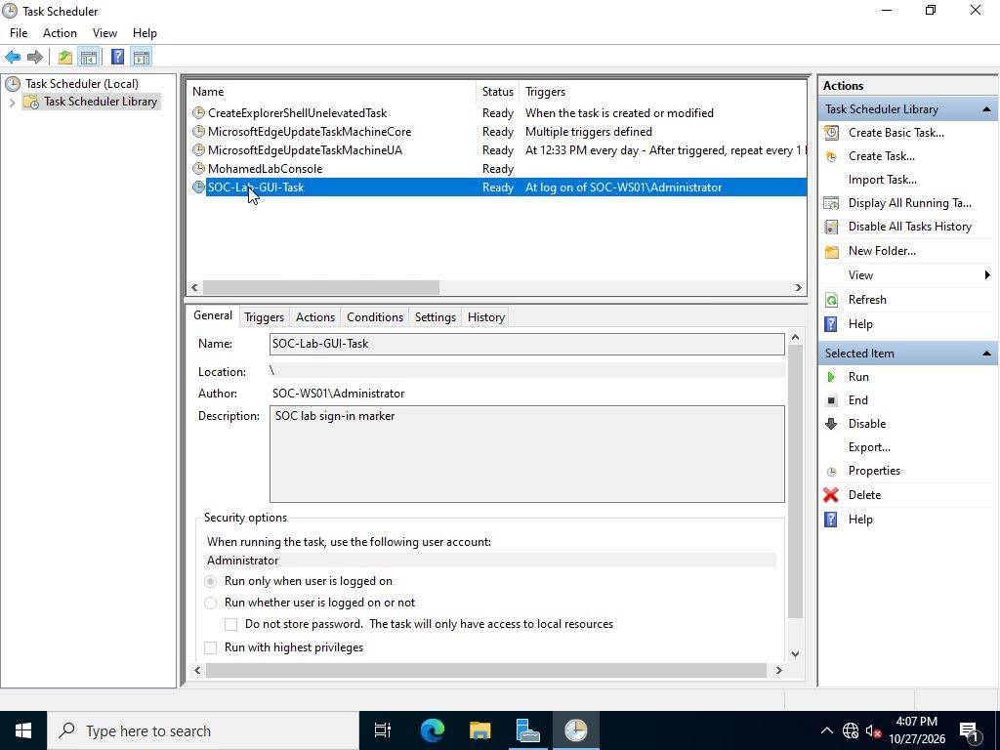
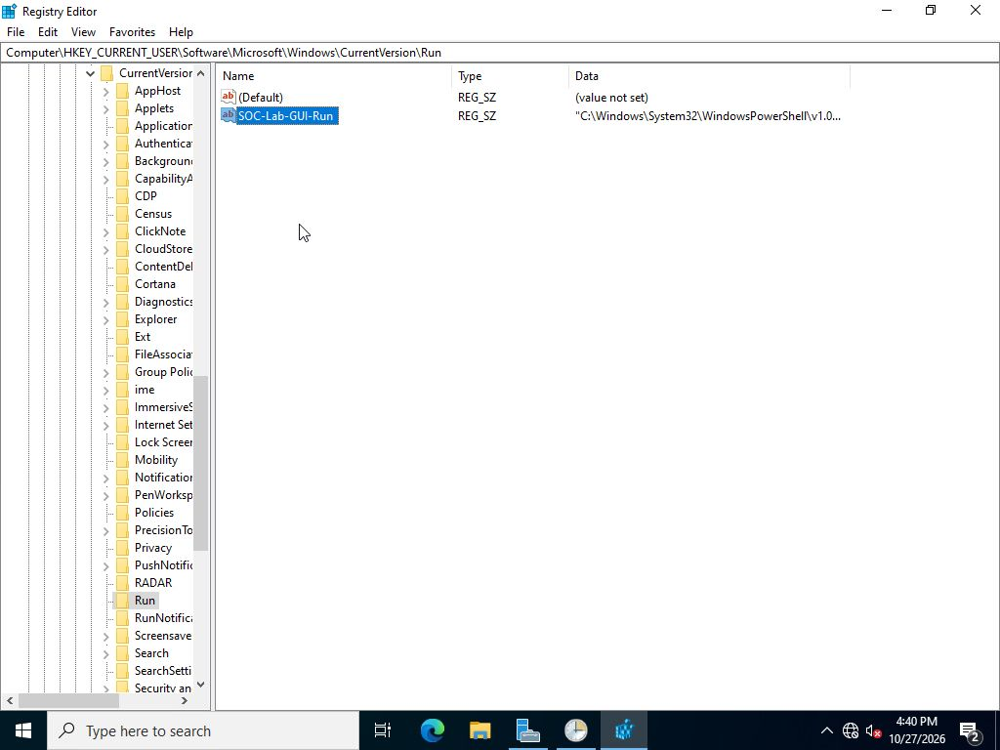
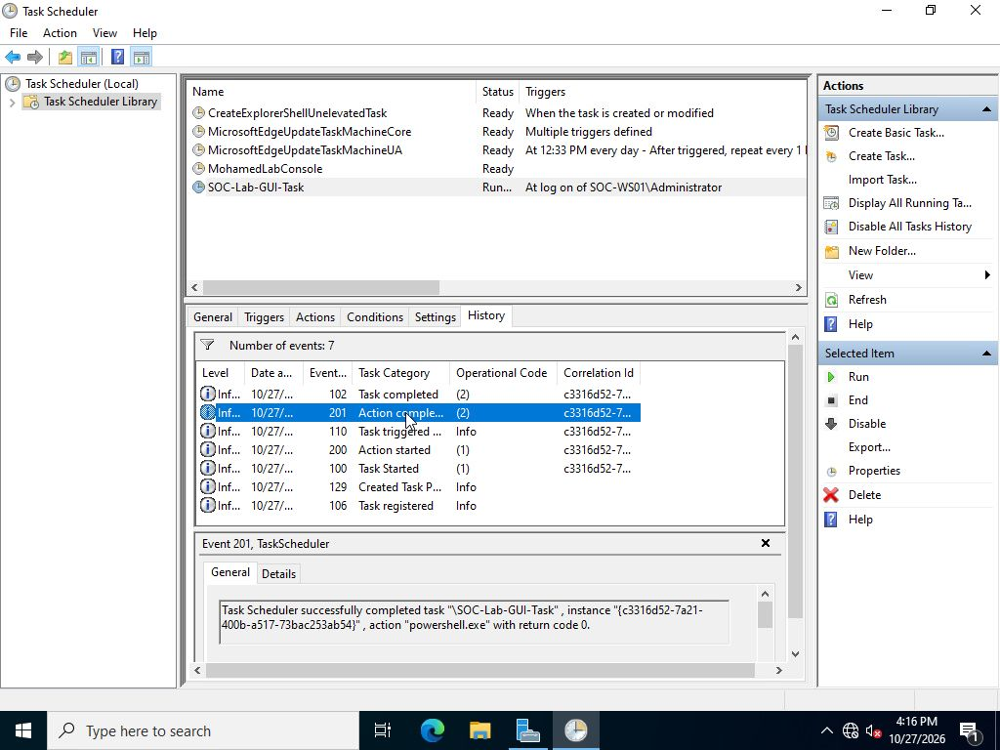
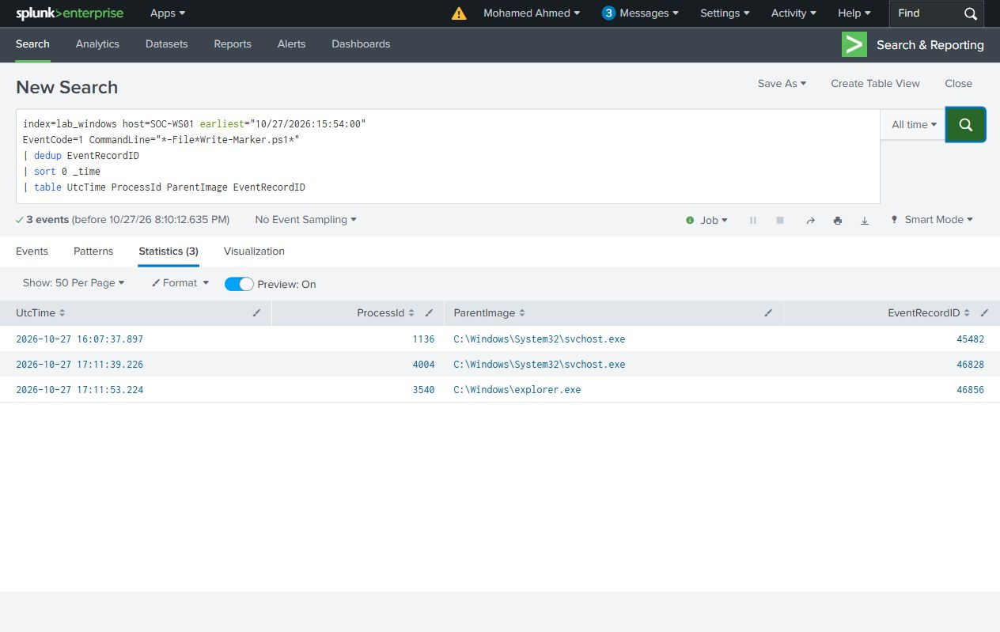

# Windows Persistence Investigation

Investigating Scheduled Tasks, Registry Run values and permanent WMI subscriptions with Windows logs and Splunk. The cases use a harmless local marker script to connect configuration changes with the processes they start.

## Cases and findings

| Mechanism | What to investigate | Observed behavior |
| --- | --- | --- |
| Scheduled Task | Trigger, principal, action and execution history | Runs the marker manually and at sign-in |
| HKCU Run value | Complete value path, command and account | Starts the marker through Explorer at sign-in |
| WMI subscription | Filter, consumer, binding and execution identity | Starts the marker through WmiPrvSE as SYSTEM |

The Task Scheduler and Registry Editor walkthroughs show creation, execution after a restart and removal. The WMI case follows its filter, consumer and binding through the recorded event history.

These are three separate persistence experiments. The investigation checks the configured action, the account that creates it, the process that later runs it, and whether the action continues after a restart.

## Verification

On `SOC-WS01`, the scheduled task returned code 0 for a manual run and the next sign-in. The Run value also produced its marker at sign-in. After both named objects were removed, another restart and confirmed sign-in produced no new marker process. The marker hashes stayed unchanged for more than five minutes after that sign-in.

Splunk results are matched to the original Windows record IDs. Each saved search answers one question: registration, value changes, process execution or cleanup.

## Investigation outcome

**The configured persistence mechanisms executed the marker script, and their removal was verified.** Task Scheduler ran it manually and at sign-in. The Run value launched it through Explorer at sign-in. The WMI subscription launched it through WmiPrvSE as SYSTEM when the `whoami.exe` condition occurred, including after a restart.

The marker records the account, PID, parent PID, computer, execution time and boot time. It connects the configured action with an observed execution. Native Windows events provide the registration, process and removal evidence; the marker script does not create the persistence objects.

The recorded cleanup removed the named lab objects. The relevant triggers were checked again and the retained marker evidence supported the absence of further case execution. For an unrecognized entry in an incident, preserve its full definition and associated script, identify its owner and purpose, and coordinate removal and verification through the response process.

## Walkthrough

- [Scheduled Task](docs/scheduled-task.md)
- [Registry Run value](docs/registry-run-key.md)
- [Permanent WMI subscription](docs/wmi-subscription.md)
- [Restart and cleanup](docs/restart-and-cleanup.md)
- [Search guide](docs/search-guide.md)
- [Lab setup](docs/setup.md)
- [Evidence index](evidence/README.md) and [image gallery](docs/screenshots.md)

## Lab and evidence

Windows Server 2022 Evaluation, Windows PowerShell 5.1, Sysmon 15.22 and Splunk Enterprise 9.4.1 on Ubuntu 24.04.

The October 18 collection identifies the standalone endpoint as `MOHAMEDAHMED` and uses index `lab_persistence`. It includes the Task, Run, WMI and control experiments. The October 27 Task and Run walkthrough uses `SOC-WS01`, joined to `soc.test`, with its local Administrator account and forwarded logs in `lab_windows`.

The repository preserves **30 source events from October 18** and **28 source events from the October 27 walkthrough**, with configuration, marker files and search results. The original host-scoped collection contains 2,281 events; those coverage counts describe that collection, not the number of selected case records in the repository.
