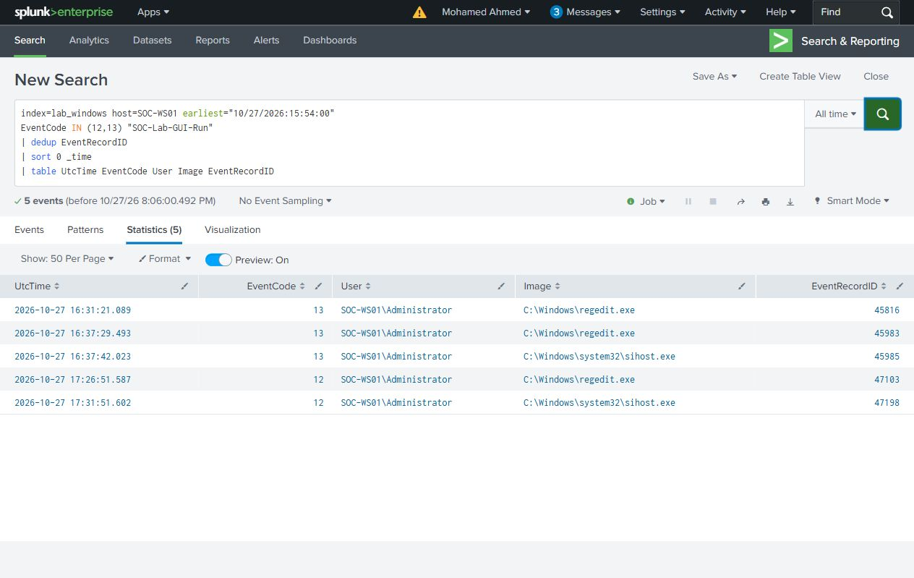
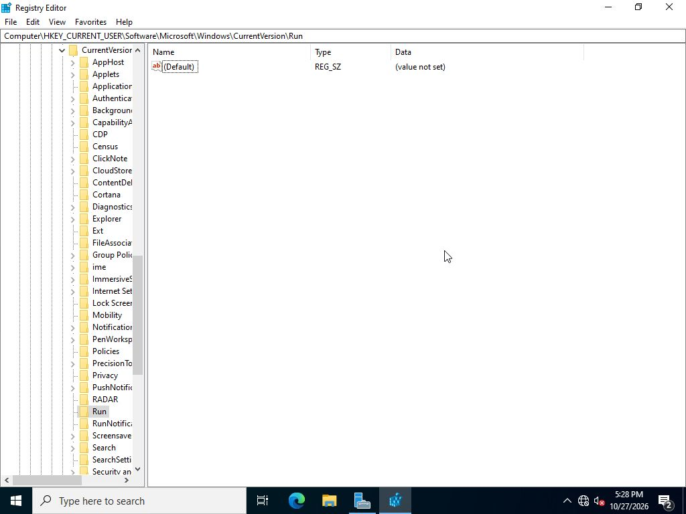

# Registry Run value

`SOC-Lab-GUI-Run` is a REG_SZ value under `HKCU\Software\Microsoft\Windows\CurrentVersion\Run`. It was added using Registry Editor for the local lab account.

Its [full value data](../evidence/gui-cases/run-value.json) starts Windows PowerShell with the marker script and `-Case Registry`.

## Execution and investigation

After restarting Windows and signing in, PowerShell PID 3540 wrote the Registry marker. Its parent is Explorer, which is consistent with execution from the per-user logon location.

The [Run search](../splunk/searches/11-gui-run-changes.spl) uses the value name and Sysmon event codes 12 and 13. Its five results include the value's empty initial state, command data, deletion and RunNotification bookkeeping. Inspect TargetObject and Details in the [native XML](../evidence/gui-cases/events.xml); these records are not five executions.

The three [process rows](../evidence/search-results/12-gui-marker-processes.csv) contain two Task launches and the single Run-value launch. The marker file records its account, PID, UTC time and boot time.

## Removal

The named value was deleted in Registry Editor. It remained absent after the verification restart, and the marker file hash did not change after the confirmed sign-in.

## October 18 comparison

The earlier `SOC-Lab-Run` experiment produced the same Explorer-to-PowerShell relationship. Original Sysmon record 523 and [Registry marker](../evidence/markers/Registry.jsonl) establish that execution. Its [two registry rows](../evidence/search-results/02-run-key-changes.csv) refer to the Run command and a RunNotification DWORD.

A writable path or ExecutionPolicy Bypass is an investigation lead. The full value, executing account, process chain and output supply the context.

ATT&CK: T1547.001 — Registry Run Keys / Startup Folder.
