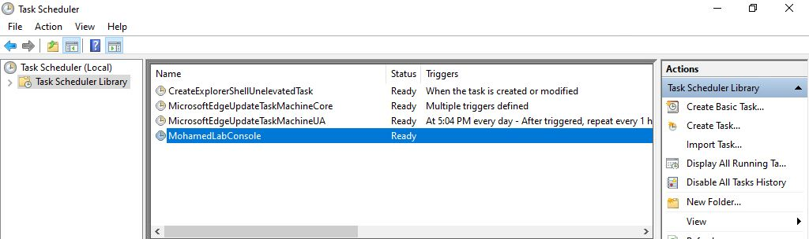
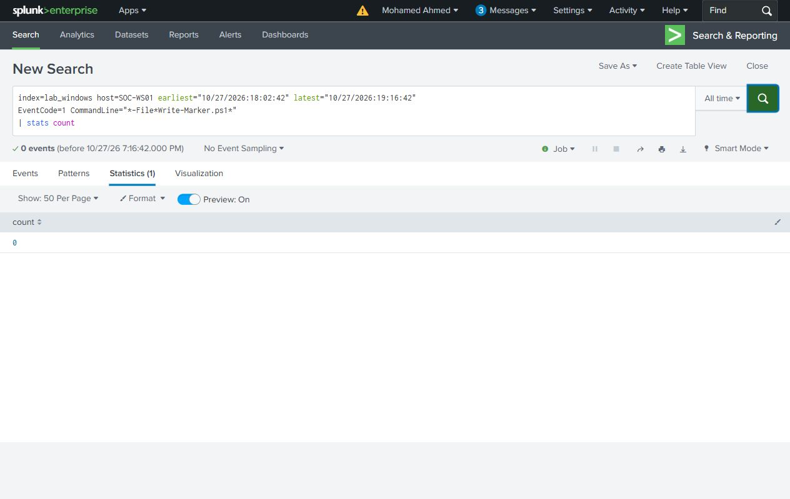

# Restart and cleanup

The marker records the executing account, PID, parent PID, UTC time and Windows boot time. This distinguishes a saved configuration from an action that actually ran.

## Task and Run walkthrough

| Stage | Task markers added | Registry markers added |
| --- | ---: | ---: |
| Manual Task Scheduler Run | 1 | 0 |
| Restart and local sign-in | 1 | 1 |
| Remove both objects, restart and sign in | 0 | 0 |

The initial boot was `12:28:41 UTC`; the execution test boot was `16:58:54 UTC` on October 27. The [three new marker records](../evidence/gui-cases/markers.jsonl) show the manual Task run followed by the Task and Registry logon launches.

The Run value and task were removed through their Windows management interfaces.

The verification boot was `18:02:42 UTC`. A successful local interactive sign-in is recorded in Security event 4624, record 42541. At `19:16:42 UTC`, more than five minutes after that sign-in, both named objects were absent, no marker process was running and all four marker-file hashes matched the values saved before the restart.

The [cleanup search](../splunk/searches/13-gui-cleanup-process-check.spl) returns a count of 0 for matching process launches in that verification window.

The [cleanup record](../evidence/gui-cases/cleanup.json) contains the observation times and before/after hashes. Existing marker records remain intact; removal stops future execution rather than deleting investigation evidence.

## Original Task, Run and WMI experiment

The October 18 experiment used the same marker design. Its [original records](../evidence/markers/) show Task, Registry, WMI and Control execution across boot times. After removal and a further restart, repeating the triggers left counts unchanged: Task 2, Registry 1, WMI 2 and Control 2.

The original [object inventory](../evidence/configuration/cleanup.json), [counts before](../evidence/configuration/marker-counts-before-clean-restart.json) and [counts after](../evidence/configuration/marker-counts-after-clean-restart.json) retain that verification. It describes the named mechanisms and triggers tested in the lab.
