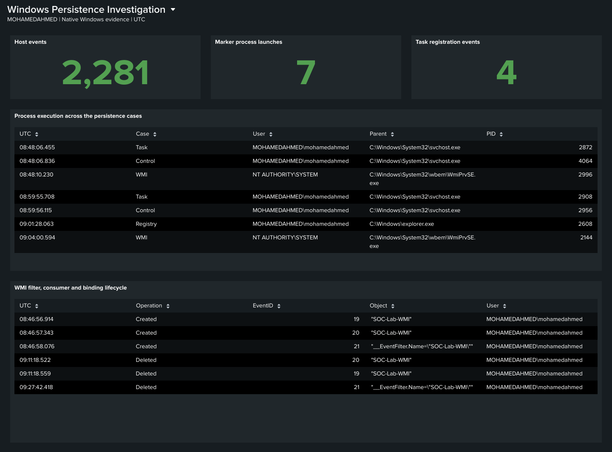
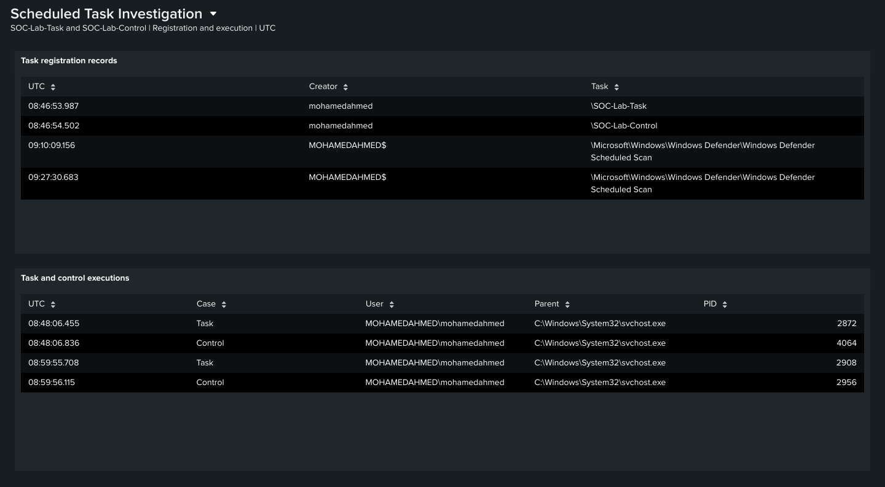
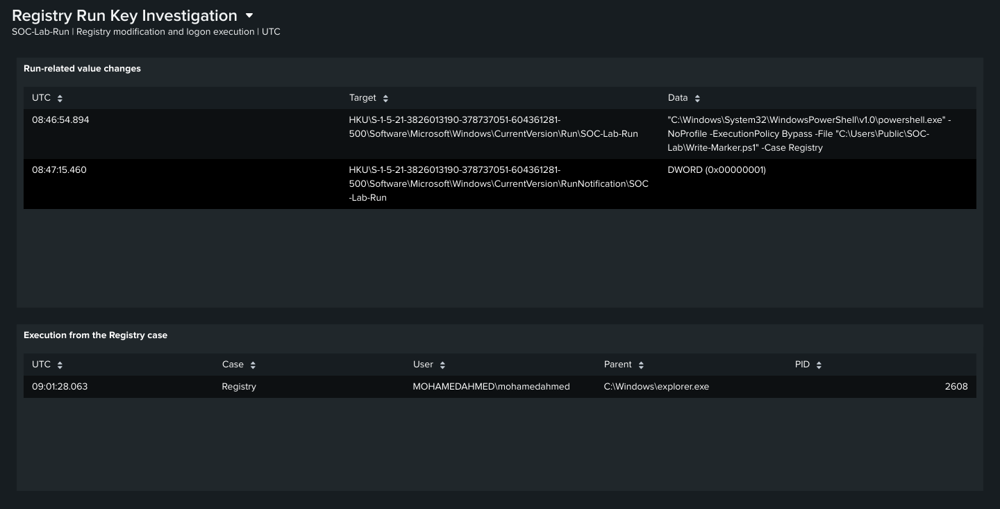
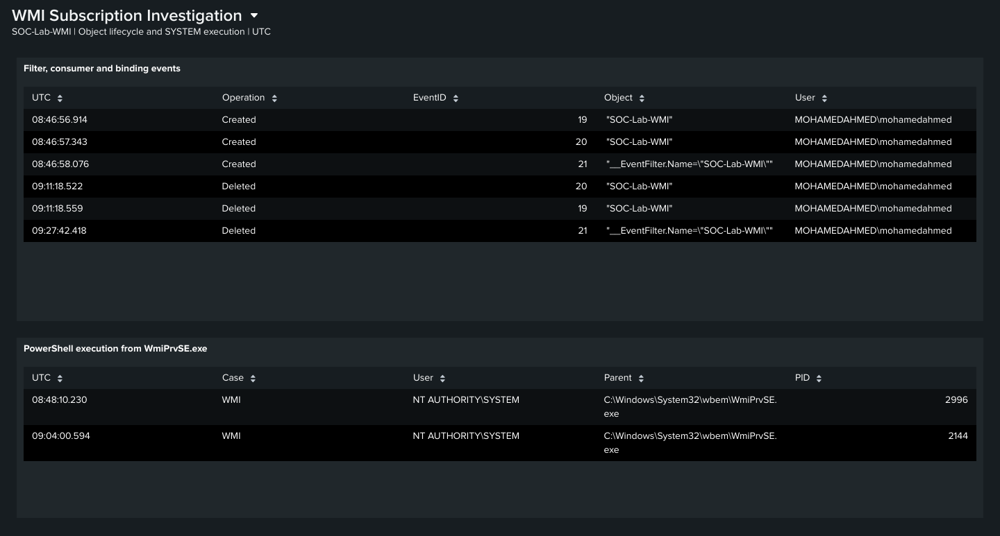
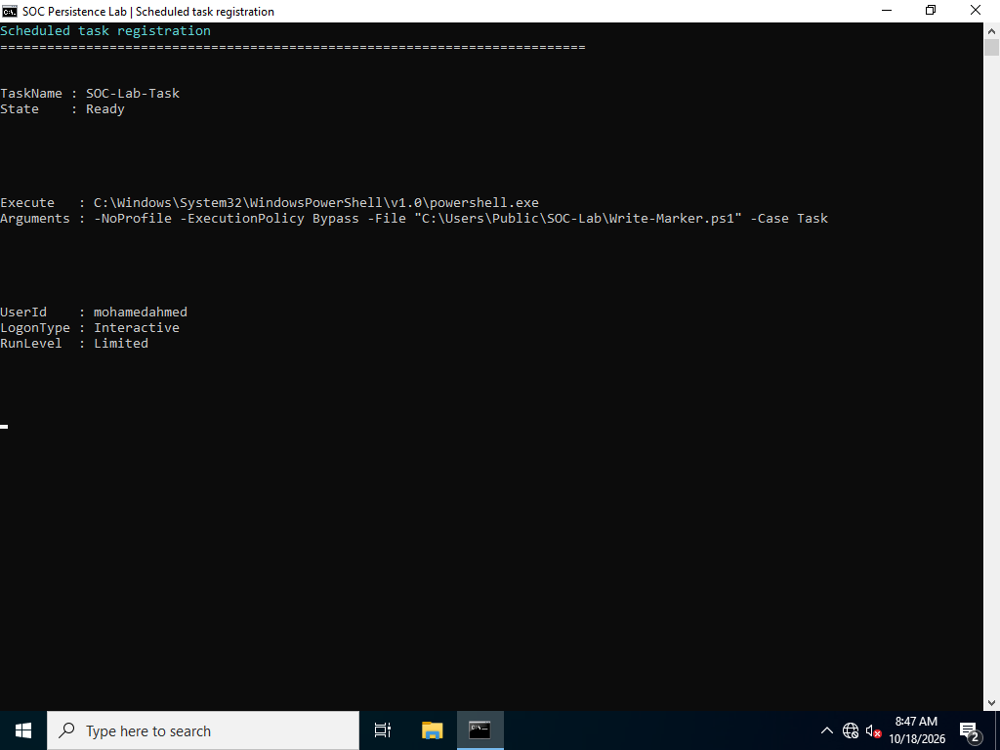
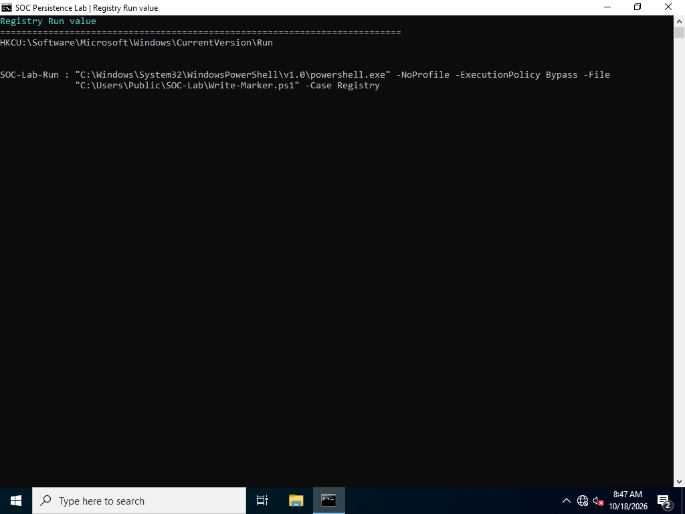
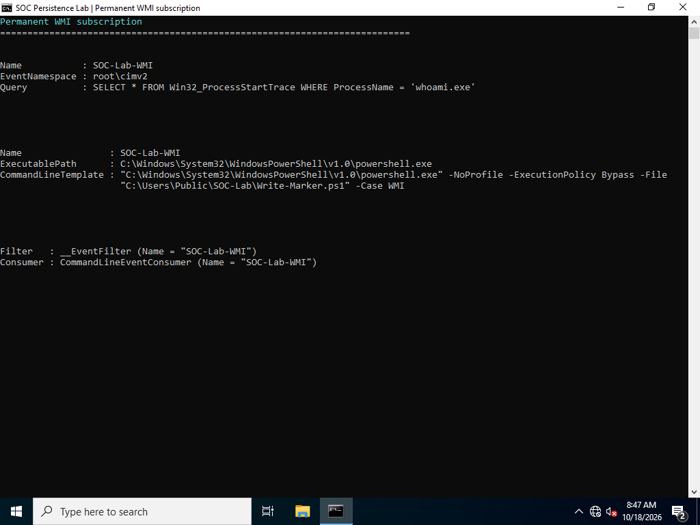
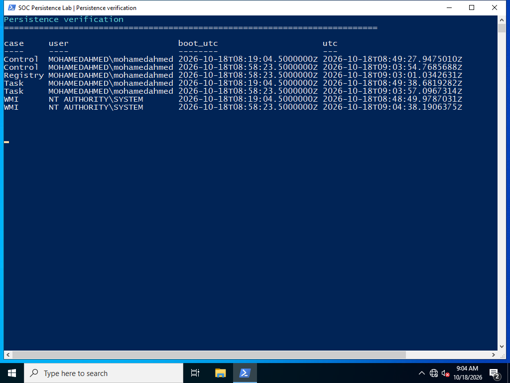
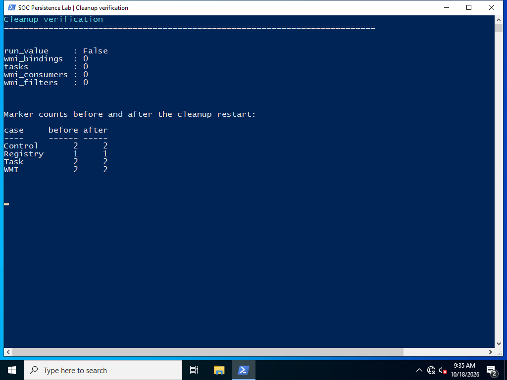

# Evidence gallery

Windows captures show the case objects, execution markers and removal checks. The Splunk images are native PNG exports of the Dashboard Studio views.

## Splunk investigation overview

## Splunk Scheduled Task investigation

## Splunk Registry Run key investigation

## Splunk WMI subscription investigation

## Scheduled Task

## Registry Run key

## WMI subscription

## Initial execution

## After restart

## Cleanup verification

