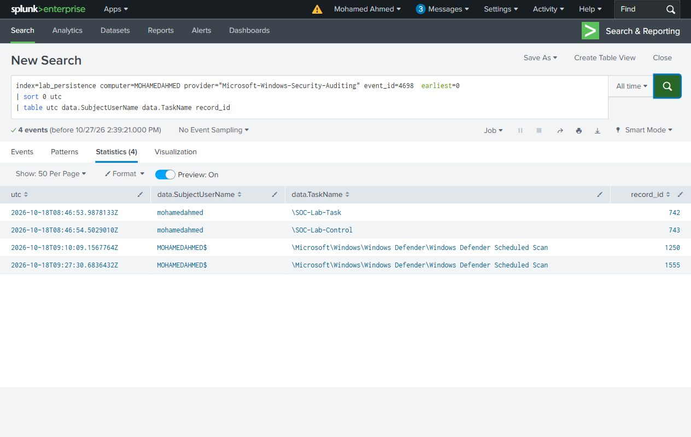
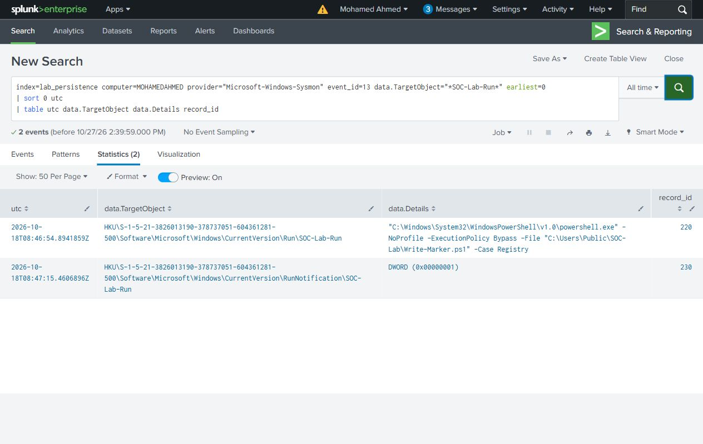
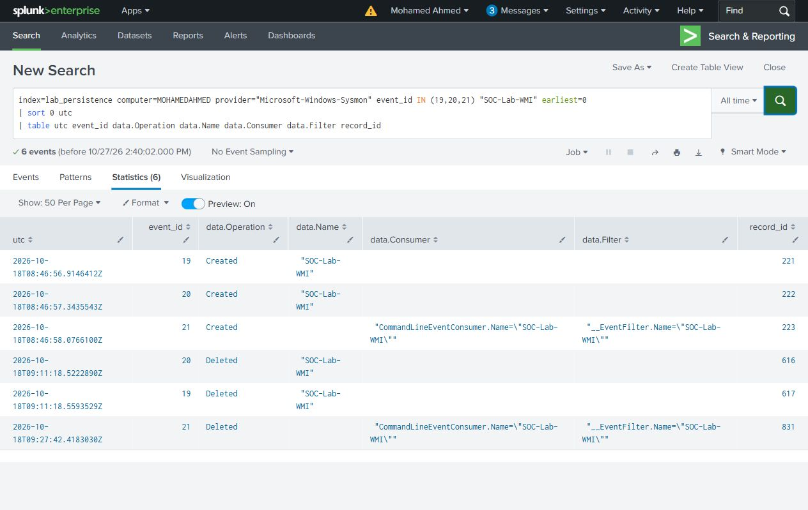
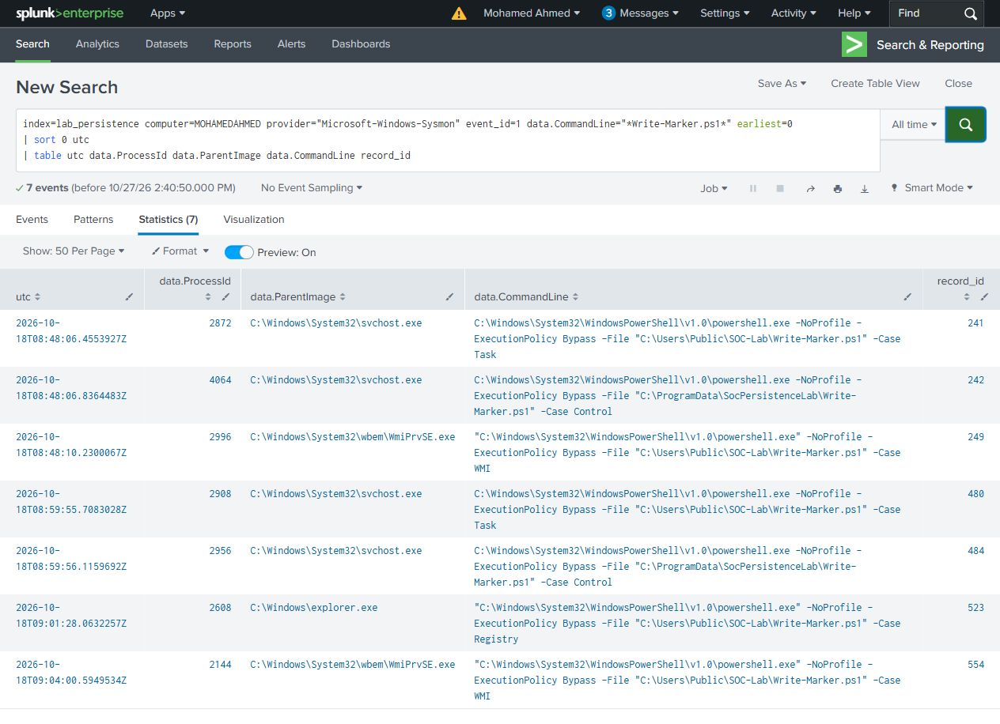
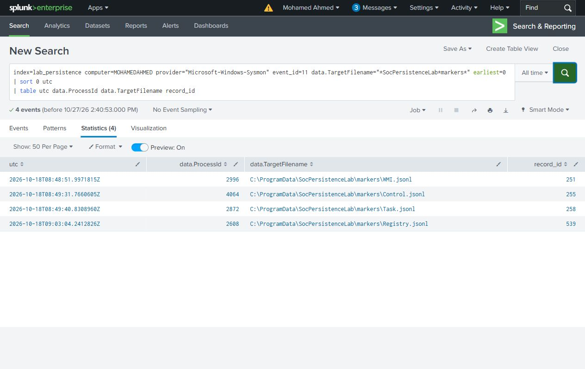
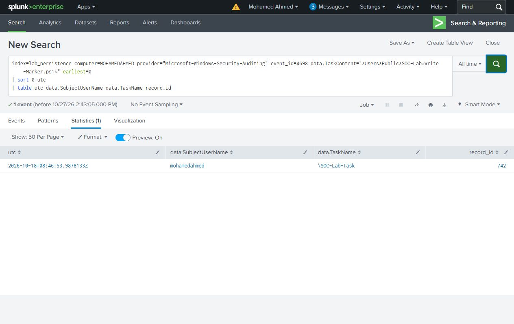
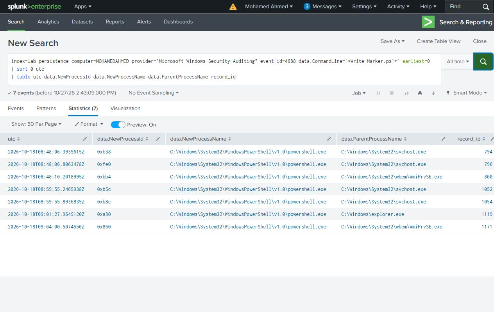
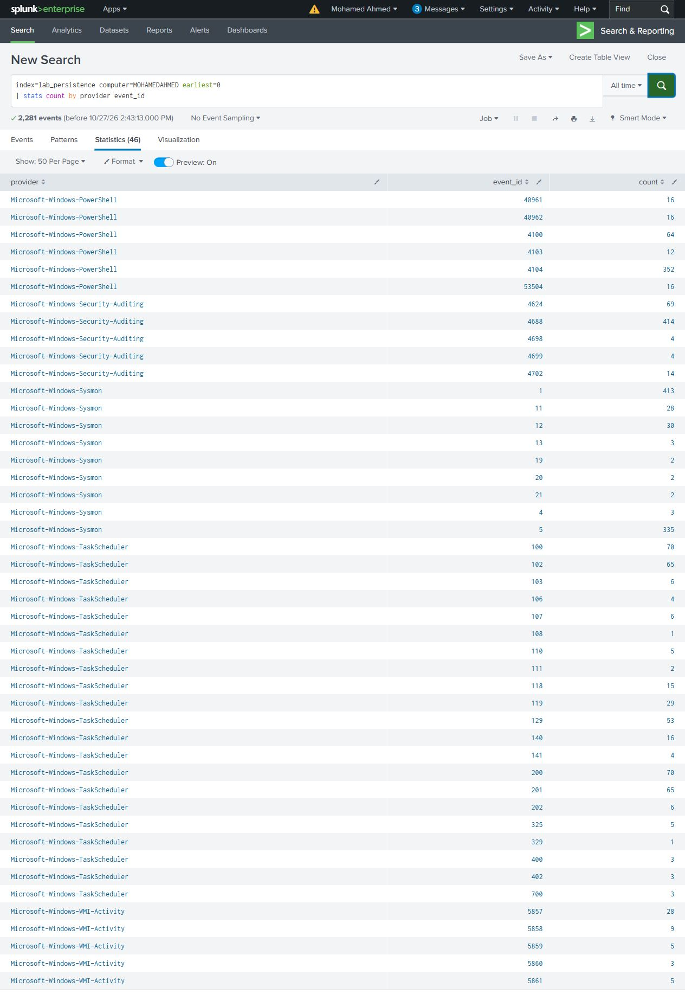
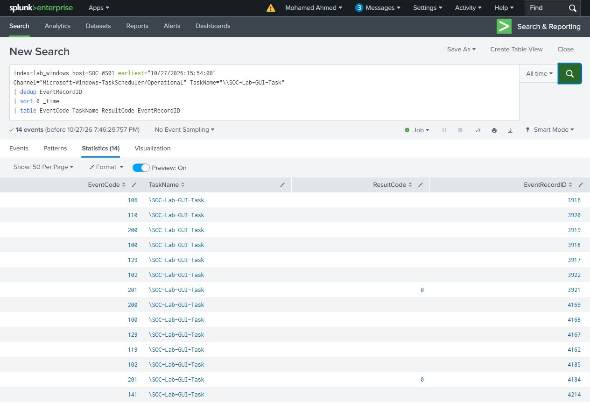
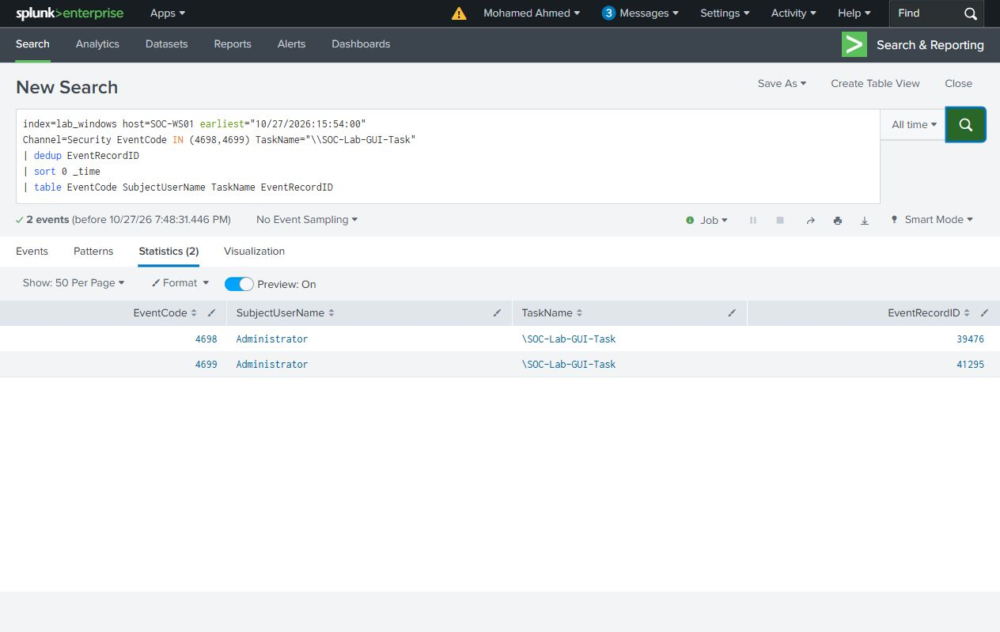

# Search guide

Choose **All time** in Splunk Search & Reporting for the recorded October 18 dataset. Source `utc` is the original Windows timestamp; `record_id` identifies its native record. `data.*` fields contain the Windows event payload.

Scope is `MOHAMEDAHMED`, the endpoint name at collection time. Each query answers one question.

## Task registration

Security 4698 identifies the creator and task name. Open TaskContent in the original event to inspect the trigger, principal and action.

```spl
index=lab_persistence computer=MOHAMEDAHMED provider="Microsoft-Windows-Security-Auditing" event_id=4698  earliest=0
| sort 0 utc
| table utc data.SubjectUserName data.TaskName record_id
```

Result: **4 rows**. [CSV](../evidence/search-results/01-task-registration.csv)



## Run value changes

Read the full target path and value data. The RunNotification entry is not another Run command.

```spl
index=lab_persistence computer=MOHAMEDAHMED provider="Microsoft-Windows-Sysmon" event_id=13 data.TargetObject="*SOC-Lab-Run*" earliest=0
| sort 0 utc
| table utc data.TargetObject data.Details record_id
```

Result: **2 rows**. [CSV](../evidence/search-results/02-run-key-changes.csv)



## WMI registration

Sysmon 19, 20 and 21 describe the filter, consumer and binding. Created and deleted objects appear in the same selected history.

```spl
index=lab_persistence computer=MOHAMEDAHMED provider="Microsoft-Windows-Sysmon" event_id IN (19,20,21) "SOC-Lab-WMI" earliest=0
| sort 0 utc
| table utc event_id data.Operation data.Name data.Consumer data.Filter record_id
```

Result: **6 rows**. [CSV](../evidence/search-results/03-wmi-registration.csv)



## Marker processes

Compare PID, parent image and command line. Use ProcessGuid in the native events to avoid confusing reused PIDs.

```spl
index=lab_persistence computer=MOHAMEDAHMED provider="Microsoft-Windows-Sysmon" event_id=1 data.CommandLine="*Write-Marker.ps1*" earliest=0
| sort 0 utc
| table utc data.ProcessId data.ParentImage data.CommandLine record_id
```

Result: **7 rows**. [CSV](../evidence/search-results/04-marker-execution.csv)



## Marker files

File creation supports the process timeline. A single file event is not a count of every later append to that file.

```spl
index=lab_persistence computer=MOHAMEDAHMED provider="Microsoft-Windows-Sysmon" event_id=11 data.TargetFilename="*SocPersistenceLab*markers*" earliest=0
| sort 0 utc
| table utc data.ProcessId data.TargetFilename record_id
```

Result: **4 rows**. [CSV](../evidence/search-results/05-marker-file-events.csv)



## Task actions in the Public path

The action-path wildcard selects the case task. The ProgramData control and Defender actions remain in the broad search.

```spl
index=lab_persistence computer=MOHAMEDAHMED provider="Microsoft-Windows-Security-Auditing" event_id=4698 data.TaskContent="*Users*Public*SOC-Lab*Write-Marker.ps1*" earliest=0
| sort 0 utc
| table utc data.SubjectUserName data.TaskName record_id
```

Result: **1 row**. [CSV](../evidence/search-results/06-task-user-path.csv)



## Security process auditing

Security 4688 provides a second source for marker-process creation.

```spl
index=lab_persistence computer=MOHAMEDAHMED provider="Microsoft-Windows-Security-Auditing" event_id=4688 data.CommandLine="*Write-Marker.ps1*" earliest=0
| sort 0 utc
| table utc data.NewProcessId data.NewProcessName data.ParentProcessName record_id
```

Result: **7 rows**. [CSV](../evidence/search-results/07-process-creation-security.csv)



## Collection coverage

The 46 provider/event combinations total 2,281 records for the original endpoint. The repository includes 30 selected native case records, not this full machine history.

```spl
index=lab_persistence computer=MOHAMEDAHMED earliest=0
| stats count by provider event_id
```

Result: **46 rows**. [CSV](../evidence/search-results/08-coverage.csv)




The following searches use forwarded Windows XML in `lab_windows` on `SOC-WS01`. These records expose native fields such as `EventCode` and `EventRecordID`; the October 18 JSON dataset uses `event_id`, `record_id` and `data.*`.

## Task Scheduler lifecycle on SOC-WS01

The 14 events cover registration, one manual run, execution at the next logon, and deletion. Event 201 records return code 0 for both executions; event 119 identifies the logon trigger.

```spl
index=lab_windows host=SOC-WS01 earliest="10/27/2026:15:54:00"
Channel="Microsoft-Windows-TaskScheduler/Operational" TaskName="\\SOC-Lab-GUI-Task"
| dedup EventRecordID
| sort 0 _time
| table EventCode TaskName ResultCode EventRecordID
```

Result: **14 rows**. [CSV](../evidence/search-results/09-gui-task-lifecycle.csv)



## Security task registration and deletion

Security 4698 records creation and 4699 records deletion of the named task. The original XML contains the action and principal.

```spl
index=lab_windows host=SOC-WS01 earliest="10/27/2026:15:54:00"
Channel=Security EventCode IN (4698,4699) TaskName="\\SOC-Lab-GUI-Task"
| dedup EventRecordID
| sort 0 _time
| table EventCode SubjectUserName TaskName EventRecordID
```

Result: **2 rows**. [CSV](../evidence/search-results/10-gui-task-security.csv)



## Run value changes on SOC-WS01

Search the value name in the raw events, then compare the five record IDs with the source XML. Read TargetObject and Details there to distinguish the Run command from RunNotification bookkeeping.

```spl
index=lab_windows host=SOC-WS01 earliest="10/27/2026:15:54:00"
EventCode IN (12,13) "SOC-Lab-GUI-Run"
| dedup EventRecordID
| sort 0 _time
| table UtcTime EventCode User Image EventRecordID
```

Result: **5 rows**. [CSV](../evidence/search-results/11-gui-run-changes.csv)


## Marker process launches

The three processes are the manual Task run, the logon Task run, and the Run-value launch. Their parent images distinguish the scheduled action from the Explorer logon action.

```spl
index=lab_windows host=SOC-WS01 earliest="10/27/2026:15:54:00"
EventCode=1 CommandLine="*-File*Write-Marker.ps1*"
| dedup EventRecordID
| sort 0 _time
| table UtcTime ProcessId ParentImage EventRecordID
```

Result: **3 rows**. [CSV](../evidence/search-results/12-gui-marker-processes.csv)


## After-removal process check

The window starts at the verification boot and ends after a confirmed local sign-in and observation interval. No matching marker process appears. Object checks and unchanged marker hashes support this result.

```spl
index=lab_windows host=SOC-WS01 earliest="10/27/2026:18:02:42" latest="10/27/2026:19:16:42"
EventCode=1 CommandLine="*-File*Write-Marker.ps1*"
| stats count
```

Result: **1 row**. [CSV](../evidence/search-results/13-gui-cleanup-process-check.csv)


